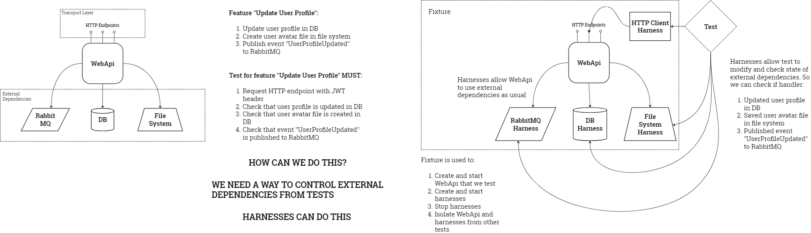

# Advanced Integration Testing

## Video Recording

https://drive.google.com/file/d/1yqUQLw4SEEdh5xaIS8o1TB1nwH4m0FWC/view?usp=sharing

## Harnesses

## Links

Demo Project - https://github.com/drim-dev/knowledge/tree/master/dotnet/aspnetcore/AspNetCoreLab/src/Testing/Testing.Tests.Integration.Advanced

Testcontainers package - https://www.nuget.org/packages/Testcontainers

MassTransit Harness - https://masstransit.io/documentation/concepts/testing

xUnit parallel tests - https://xunit.net/docs/running-tests-in-parallel

xUnit shared context - https://xunit.net/docs/shared-context.html
